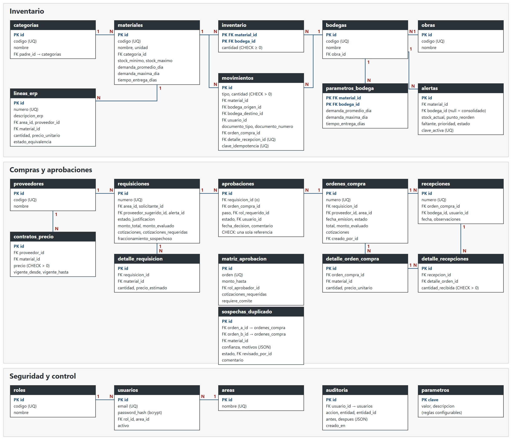

# Modelo de datos



MySQL 8, 25 tablas. Las llaves, índices y relaciones están en `backend/prisma/schema.prisma`. Las restricciones CHECK están en la migración `restricciones_check`.

## Inventario

| Tabla | Propósito |
|---|---|
| `categorias` | Taxonomía de dos niveles mediante `padre_id` |
| `materiales` | Catálogo normalizado con mínimo, máximo, demanda y tiempo de entrega. No guarda stock ni punto de reorden |
| `lineas_erp` | Las 8 líneas de A2 con su texto original, material normalizado y estado de equivalencia |
| `obras` | Proyectos de construcción |
| `bodegas` | Ubicaciones físicas; `obra_id` es nulo en Bodega Central |
| `parametros_bodega` | Demanda propia opcional de una bodega |
| `movimientos` | Fuente de verdad del stock. Inmutable. Un CHECK exige las ubicaciones correctas por tipo |
| `inventario` | Saldo derivado por material y bodega. Se actualiza en la transacción del movimiento. CHECK impide negativos |
| `alertas` | Alertas de reorden. `clave_activa` única impide dos alertas abiertas iguales y se vuelve nula al cerrar |

## Compras

| Tabla | Propósito |
|---|---|
| `proveedores` | Empresas proveedoras |
| `contratos_precio` | Precios pactados con vigencia, referencia para A3 |
| `requisiciones`, `detalle_requisicion` | Solicitudes internas, monto evaluado y marca de fraccionamiento |
| `matriz_aprobacion` | Tramos configurables de aprobación |
| `aprobaciones` | Pasos, decisión, usuario, fecha y comentario. Un CHECK exige una sola referencia a requisición u orden |
| `ordenes_compra`, `detalle_orden_compra` | Órdenes y sus líneas |
| `recepciones`, `detalle_recepciones` | Lo recibido; cada línea genera una entrada de inventario |
| `sospechas_duplicado` | Pares sospechosos, motivos y revisión humana |

## Seguridad y control

| Tabla | Propósito |
|---|---|
| `roles`, `usuarios`, `areas` | Accesos; la contraseña se guarda con bcrypt |
| `parametros` | Reglas configurables de detección |
| `auditoria` | Quién cambió qué, con estado anterior y posterior. Inmutable desde la aplicación |

## Cómo se obtiene el stock

```sql
SELECT bodega_id, SUM(delta) FROM (
  SELECT bodega_destino_id AS bodega_id,  cantidad AS delta FROM movimientos WHERE bodega_destino_id IS NOT NULL
  UNION ALL
  SELECT bodega_origen_id  AS bodega_id, -cantidad AS delta FROM movimientos WHERE bodega_origen_id  IS NOT NULL
) t GROUP BY bodega_id;
```

Un movimiento tiene una sola fila: la entrada usa destino, la salida origen y el traslado ambos. Así, un traslado no altera el total por construcción.

## Normalización

Los datos repetidos viven en su propia tabla y se referencian por llave. El total de una orden se conserva como valor histórico del documento, y el saldo de `inventario` es una redundancia controlada que el reporte de conciliación verifica contra los movimientos.
